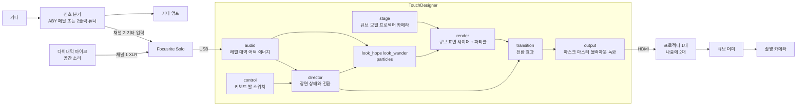

# Beta 콘텐츠 기획 — 큐브 프로젝션 매핑 뮤직비디오

> 상태: 확정 (2026-10-19) · 다음 단계: [8. 첫 번째로 만들 부분 — 중간 발표 시안](#8-첫-번째로-만들-부분--중간-발표-시안)

## 1. 한눈에 보기

| 항목 | 내용 |
|---|---|
| 결과물 | 1곡의 뮤직비디오 + 퍼포먼스 영상 (관객 없음) |
| 장소 | 합주실. 가운데 쌓은 큐브 더미에 3D 프로젝션 매핑. 밴드는 큐브를 둘러싸고 사방에서 연주 |
| 입력 | 오디오만 받음: 기타(분기 신호) + 다이내믹 마이크(공간 소리) → Focusrite Solo → 맥북 |
| 출력 | 프로젝터 1대로 시작 → 최종 2대 이상 (방법은 [열린 질문](#9-열린-질문)) |
| 공연·촬영 PC | 맥북 (M1·M2 기본 칩, 외부 화면 1대) |
| 개발 PC | 이 Windows PC (TDMCP + Claude Code) |
| 조작 | 소리에 자동 반응 + 꼭 필요할 때만 연주자가 장면을 강제 전환 |
| 질감 | 사진·영상 소스 없이 전부 TouchDesigner에서 생성 |
| 일정 | 중간 발표 2026-10-21 (가상 큐브 시안) · 첫 촬영 1~3개월 안 (2026년 11월 중순 ~ 2027년 1월 중순) |
| 곡 | 1곡, 원곡 `Blue Rock.wav` (레포 폴더에 있지만 git에는 올리지 않음) |

## 2. 콘셉트

**주제:** 불확실한 미래 속에서 방황하는 청춘의 괴롭고 아름다운 모습.

두 장면이 곡 흐름에 따라 섞이며 오갑니다. 특정 파트(벌스, 후렴 등)에 고정하지 않고, 곡의 에너지가 크게 바뀌는 순간에 넘어갑니다.

| | 장면 A — 희망 (초록) | 장면 B — 방황 (뒷골목) |
|---|---|---|
| 느낌 | 어두운 숲에 비치는 초록 빛. 고요하지만 살아 있음 | 주황·네온빛 저녁 골목. 흔들리고 깨지고 번짐 |
| 색 | 검정 바탕 + 초록·청록, 가끔 무지갯빛 반짝임 | 주황·호박색 + 네온 분홍·보라, 그림자는 짙게 |
| 큐브 면 | 모서리를 따라 흐르는 가는 빛 선, 면 안쪽으로 겹겹이 들어가는 사각 프레임 | 가로로 미끄러지는 글리치 띠, 면이 타일로 쪼개져 밀려남 |
| 공간 | 위에서 큐브 더미를 훑고 지나가는 빛줄기 (여러 큐브에 이어서 떨어짐) | 아래에서 위로 흐르는 세로 빛 잔상 (장노출로 찍은 도시 불빛) |
| 파티클 | 초록 잎·빛 입자가 천천히 떠오름 | 주황 불씨·재가 흩날리고 비트에 튐 |
| 레퍼런스 섹션 | 채택(윗줄), 자유로운 | 채택(아랫줄), 방황 뒷골목 혼란 |

**전환:** 소용돌이처럼 도는 모션 블러 + RGB가 갈라지는 글리치 (레퍼런스 "그 사이 어떤 전환"). 1~2초.

**공통 요소, Alpha에서 이어 오는 파티클:** Alpha의 꽃잎 파티클처럼 소리에 반응하는 파티클이 두 장면 내내 떠 있고, 장면에 따라 색·모양·움직임만 바뀝니다. 두 장면을 한 작품으로 묶어 주는 역할입니다.

**큐브 바깥:** 기본은 검정입니다(큐브에만 빛이 닿음). 연주자에게 빛이 번지는 연출을 넣을지는 열린 질문입니다.

**레퍼런스:** Figma 보드 "베타" (섹션: 채택 / 자유로운 / 방황 뒷골목 혼란 / 그 사이 어떤 전환). 레퍼런스 이미지는 분위기 참고용이고, 영상에는 TouchDesigner에서 만든 것만 씁니다.

## 3. 제작 조건과 제약

- **라이선스:** 무료(Non-Commercial) 라이선스는 모든 이미지가 최대 1280×1280입니다. 1단계는 프로젝터 1대에 1280×720(또는 프로젝터에 맞춘 1280×800)이라 무료로도 됩니다. 프로젝터 2대를 한 화면으로 묶거나 해상도를 올리려면 Educational($300, 학생·학교, 비상업 용도) 또는 Commercial($600)이 필요합니다. 영상으로 수익이 생기면 Commercial이 필요합니다.
- **맥북 M1·M2 기본 칩:** 외부 화면을 1대만 지원합니다. 프로젝터 2대는 별도 방법이 필요합니다(열린 질문 2).
- **TD 빌드:** 맥에도 2025.33230 이상을 설치합니다(지금 Windows와 같은 빌드). 새 빌드에서 저장한 `.toe`는 예전 빌드에서 열리지 않을 수 있습니다.
- **이식성:** 경로는 모두 상대 경로(`project.folder` 기준)로 씁니다. Windows 전용 기능(Spout, DirectX 텍스처 공유 등)은 쓰지 않습니다. Alpha에서 맥으로 옮길 때와 같은 방식입니다.
- **Focusrite Solo:** XLR 마이크 입력(채널 1)과 기타·라인 입력(채널 2)을 동시에 받습니다.
- **성능 목표:** 맥북에서 1280×720, 60fps. 렌더 1번 + GPU 파티클 + 후처리 몇 개 정도의 규모입니다.

## 4. 신호 흐름 (입력 → 출력)



1. **소리 받기:** 기타 신호를 앰프로 가기 전에 둘로 나눠 하나는 앰프로, 하나는 Focusrite 채널 2로 보냅니다. 다이내믹 마이크는 공간 소리(드럼 포함)를 채널 1로 받습니다. Focusrite 게인은 가장 큰 부분에서도 입력 링이 빨간색이 되지 않게 맞춥니다. Alpha에서는 이 단계에서 소리가 찌그러져(클리핑) 이후 처리가 불가능했습니다.
2. **분석 (`audio`):** 채널마다 레벨, 대역(저·중·고), 어택(평소보다 갑자기 커진 정도), 에너지(몇 초 단위 평균)를 0~1 값으로 만듭니다.
3. **판단 (`director`):** 에너지 변화로 장면 A/B를 정하고 전환 진행값을 만듭니다. 연주자의 강제 전환(`control`)이 들어오면 그걸 우선합니다.
4. **그리기 (`look_*`, `particles`, `render`):** 큐브 3D 모델 위에 두 장면을 전환 진행값으로 섞어 그리고, 프로젝터 위치에 맞춘 카메라로 렌더합니다.
5. **내보내기 (`transition`, `output`):** 전환 효과를 얹고, 큐브 바깥을 검정으로 가린 뒤 프로젝터로 보냅니다.

## 5. 주요 COMP 구조 초안

```
/project1                       (루트, 단축키 Project)
├─ audio        (Audio)       오디오 입력·분석            → null_audio (CHOP)
├─ control      (Control)     키보드·발 스위치            → 명령 채널 (CHOP)
├─ director     (Director)    장면 상태                   → scene, mix, transition (CHOP)
├─ stage        (Stage)       table_cubes → 큐브 3D 모델, cam_proj1(·2), cam_preview
├─ look_hope    (LookHope)    장면 A 파라미터·보조 텍스처
├─ look_wander  (LookWander)  장면 B 파라미터·보조 텍스처
├─ particles    (Particles)   공통 파티클 (POP)
├─ render       (Render)      큐브 표면 셰이더(GLSL MAT) + 파티클 → 프로젝터별 renderTOP
├─ transition   (Transition)  소용돌이 블러 + RGB 분리
└─ output       (Output)      큐브 마스크·마스터·블랙아웃·테스트 패턴·슬레이트·녹화 → window COMP
```

괄호 안은 parent shortcut입니다. 지금 `/project1`에 있는 TD 기본 예제(noise1 → displace1 → geo1 → out1)는 정리 여부를 1단계 시작 때 함께 정합니다.

### audio — 오디오 입력·분석
- **입력 선택 `Source`:** Live(`audiodevinCHOP`, Focusrite) / File(합주 녹음 wav). 개발할 때는 녹음 파일로 같은 소리를 반복 재생하며 맞춥니다.
- **채널:** `room`(채널 1, 마이크), `guitar`(채널 2).
- **처리:** 게인 → 피크 측정(클리핑 표시) → 대역 나누기(room: 저·중·고) → 빠른 엔벨로프와 느린 평균 → 어택 = 빠른 값 − 느린 평균 → 에너지 = 몇 초 평균.
- **출력 `null_audio`:** `room_level`, `room_low`, `room_mid`, `room_high`, `room_onset`, `guitar_level`, `guitar_onset`, `energy`, `clip_room`, `clip_guitar`.
- **커스텀 파라미터:** `Source`, `Roomgain`, `Guitargain`, `Attack`, `Release`, `Slowtime`, `Onsetthreshold`.
- **Alpha와 다른 점:** Alpha는 RMS 값 하나(`math1` → `audio_clamp` → `lag1`)였습니다. Beta는 입력 단계 클리핑을 눈으로 확인할 수 있고, 절대 크기 대신 "평소보다 커진 정도"를 쓰기 때문에 소리가 계속 커도 반응이 1에 붙어 버리지 않습니다.

### control — 키보드·발 스위치
- `keyboardinCHOP`(맥북 키)으로 시작하고, 나중에 MIDI 발 스위치(`midiinCHOP`)를 추가합니다. 키와 명령의 연결은 표(`table_keymap`)로 둡니다.
- **명령(초안):** `1` 희망, `2` 방황, `A` 자동 복귀, `B` 블랙아웃, `S` 슬레이트, `T` 테스트 패턴.
- **주의:** 키보드 입력은 TD 창이 활성화돼 있어야 받습니다. 키보드를 흉내 내는 USB 페달도 마찬가지입니다. MIDI 발 스위치는 창 활성화와 상관없습니다.

### director — 장면 상태
- **모드:** Auto / Manual. 수동 명령이 들어오면 Manual로 바뀌고, `A` 명령으로 Auto로 돌아갑니다.
- **자동 규칙(초안):** 에너지가 크게 바뀌는 순간(섹션이 바뀌는 지점)을 감지하면 장면을 바꿉니다. 최소 유지 시간(예: 8초)과 최대 유지 시간(예: 40초)으로 너무 잦거나 너무 오래 머무는 걸 막습니다. 세부 값은 합주 녹음으로 맞춥니다.
- **출력:** `scene`(0 = 희망, 1 = 방황), `mix`(0~1, 전환 시간 동안 부드럽게 변함), `transition`(전환 중 1).
- 소리가 같으면 같은 곳에서 전환되도록 규칙을 결정적으로 만듭니다. 그래야 여러 테이크를 찍어도 편집할 때 맞추기 쉽습니다.

### stage — 큐브 모델과 프로젝터 카메라
- **`table_cubes`:** `name, tx, ty, tz, sx, sy, sz, ry`. 큐브가 완성되면 숫자만 고칩니다.
- 큐브 면마다 UV 0~1(모서리·프레임 효과용)과 월드 좌표(여러 큐브를 가로지르는 빛줄기·띠 효과용)를 함께 씁니다.
- **`cam_proj1`:** 실제 프로젝터의 위치와 렌즈에 맞춘 카메라입니다. 합주실에서 camSchnappr(Palette)로 보정하고, 보정값과 다시 보정하는 절차를 남겨 둡니다.
- **`cam_preview`:** 집에서 작업할 때 3D 결과를 보는 자유 카메라입니다.

### look_hope / look_wander — 장면
- 사진 없이 TD에서 만듭니다. 장면 하나 = 표면 셰이더 파라미터 묶음 + 보조 텍스처(노이즈, 피드백 TOP).
- **오디오 연결 예:** 빛줄기 밝기·속도 ← `room_low`, `energy` / 글리치 띠 ← `room_onset` / 프레임 깜빡임 ← `guitar_onset`.

### particles — 공통 파티클
- POP 파티클이 큐브 표면에서 생겨나 표면을 타고 흐르거나 떠오릅니다. 허공에 뜬 파티클은 프로젝터 시점에서 뒤쪽 면이나 벽에 찍혀 촬영 카메라에서는 엉뚱한 곳에 보이므로, 표면 위주로 움직이게 합니다.
- 양·속도 ← `guitar_level`, `guitar_onset` / 색·모양 ← director의 `mix`.

### render — 렌더
- 큐브 표면 셰이더(GLSL MAT) 하나가 장면 A와 B를 `mix` 값으로 섞어 그립니다. 그래서 두 장면이 중간 상태로도 자연스럽게 섞입니다.
- 프로젝터 카메라마다 `renderTOP`을 하나씩 둡니다(1280×720).

### transition — 전환 효과
- 렌더 결과 위에 소용돌이 블러와 RGB 분리 글리치를 얹습니다. 강도는 director의 `transition` 값을 따릅니다.

### output — 출력
- 큐브만 흰색으로 렌더한 마스크를 곱해 큐브 바깥은 검정으로 만듭니다.
- 마스터 밝기, 블랙아웃, 테스트 패턴(면마다 격자와 번호, 보정용), 슬레이트 플래시를 둡니다.
- `windowCOMP` → 프로젝터 (Perform 모드).
- 선택: Movie File Out으로 출력 녹화(편집 소스용). 맥 부하와 코덱을 확인한 뒤 정합니다.

## 6. 라이브 조작 항목

| 구분 | 항목 | 방법 | 언제 |
|---|---|---|---|
| 자동 | 장면 전환 | director 자동 규칙 | 연주 중 |
| 자동 | 파티클 양·속도 | 기타 레벨·어택 | 연주 중 |
| 자동 | 빛줄기·글리치 강도 | 공간 마이크 대역·어택 | 연주 중 |
| 연주자 (가끔) | 장면 A/B 강제 전환, 자동 복귀 | 발 스위치 또는 맥북 키 | 자동 전환이 어긋날 때만 |
| 테이크 전 | 입력 게인 보정 | Focusrite 노브 + `Roomgain`/`Guitargain`, 클리핑 표시 확인 | 사운드체크 |
| 테이크 시작 | 슬레이트 플래시 | 키 하나 → 큐브 전체 0.2초 흰색 (+ 박수) | 편집할 때 영상과 소리를 맞추는 기준 |
| 테이크 사이 | 장면 고정 | Manual 모드 | 특정 장면만 따로 찍을 때 |
| 비상 | 블랙아웃, 마스터 밝기 | 키 | 언제든 |
| 설치 | 테스트 패턴, 프로젝터 보정 | output, stage | 합주실에 설치할 때 |

## 7. 단계별 제작 순서

각 단계는 CLAUDE.md의 순서(`td-build-planning` → 빌더 스킬 → `td-review-network` → `td-network-cleanup`)를 따르고, 작은 단위로 만들어 단계마다 확인합니다.

| 단계 | 내용 | 어디서 | 완료 기준 |
|---|---|---|---|
| 시안. 중간 발표 | 가상 큐브 3D 미리보기 + 장면 A + 파티클, 원곡 wav로 반응 ([8번](#8-첫-번째로-만들-부분--중간-발표-시안)) | Windows PC | 8번의 완료 기준 (2026-10-21 발표) |
| 0. 기술 확인 | 맥에 TD 2025.33230 설치, Beta.toe 열기, 맥에서 Focusrite Solo 2채널 입력 확인, 프로젝터 연결, 라이선스 결정 | 맥북 | 맥에서 Beta.toe가 에러 없이 열리고 2채널 입력이 보임 |
| 1. audio | 시안의 간단한 오디오 분석을 실제 입력용으로 확장 ([8-2](#8-2-그다음--audio-comp-확장)) | Windows PC | 8-2의 완료 기준 |
| 2. stage | 큐브 표 + 3D 모델 + 프로젝터 카메라 + 테스트 패턴. 큐브 완성 전에는 임시 박스로 보정 연습 | Windows PC → 합주실 | 테스트 패턴 격자가 실제 큐브 모서리에 맞음 |
| 3. render + look_hope | 표면 셰이더 + 장면 A | Windows PC | 3D 미리보기에서 장면 A가 녹음 파일에 반응 |
| 4. particles | 공통 파티클 | Windows PC → 맥북 | 맥북에서 60fps 유지 |
| 5. look_wander | 장면 B | Windows PC | 장면 B가 녹음 파일에 반응 |
| 6. director + control + transition | 자동 전환 + 수동 덮어쓰기 + 전환 효과 | Windows PC | 녹음 한 곡 동안 전환이 의도한 곳에서 일어나고, 키로 덮어쓸 수 있음 |
| 7. 합주실 리허설 | 실제 큐브·프로젝터·카메라로 한 곡 전체. 카메라 깜빡임, 노출, 슬레이트 확인 | 합주실 | 테스트 촬영본에 깜빡임이 없고 편집 싱크가 맞음 |
| 8. 프로젝터 2대 | 라이선스와 연결 방법을 정한 뒤 `cam_proj2` 추가 | 합주실 | 두 프로젝터의 빛이 큐브 위에서 어긋나지 않음 |

**시간 배분 (1~3개월 기준):** 시안 이틀, 0~2단계 첫 2~3주, 3~6단계 4~6주, 7단계는 촬영 2주 전. 시안에서 만든 stage·장면 A·파티클은 버리지 않고 2~4단계의 첫 버전으로 이어 씁니다. 1달 안에 찍어야 하면 장면 A + 파티클 + 수동 전환만으로 줄입니다.

**촬영 체크 (7단계):**
- 프로젝터 화면을 카메라로 찍으면 깜빡임이나 줄무늬가 생길 수 있습니다. 셔터 1/50 또는 1/60과 프레임레이트 조합을 미리 테스트합니다. DLP 프로젝터는 무지개 현상이 생길 수 있습니다.
- 큐브는 밝고 연주자는 어두워 노출 차이가 큽니다. 연주자 조명이 따로 필요한지 확인합니다.

## 8. 첫 번째로 만들 부분 — 중간 발표 시안

### 8-1. 시안 (2026-10-21 중간 발표)

**목표:** TD 안의 가상 큐브 더미에 장면 A(희망)가 투사된 모습을, 천천히 도는 카메라로 보여 줍니다. 원곡 `Blue Rock.wav`에 맞춰 빛과 파티클이 반응합니다.

**보여 줄 것**
- 어두운 합주실 바닥 위에 쌓인 흰 큐브 더미 (가상, 크기와 배치는 임시)
- 큐브 모서리를 따라 흐르는 초록 빛 선, 면 안쪽으로 겹겹이 들어가는 사각 프레임 (비트에 맞춰 안쪽으로 밀려 들어감)
- 위에서 큐브 더미를 훑고 지나가는 빛줄기 (저음·에너지에 반응)
- 무지갯빛 반짝임 (고음에 반응)
- Alpha에서 발전시킨 파티클: 큐브 표면에서 생겨나 초록 잎·빛 입자로 떠오름. 양·크기·밝기는 소리를 따르고, 어택에서 한꺼번에 터지고, 잔상이 남음
- 빛 번짐(블룸), 옅은 안개 느낌, 화면 가장자리 어둡게(비네팅)

**구조:** 버리는 시안이 아니라 5번의 본 구조를 작게 먼저 만듭니다.
- `audio`: File 입력(원곡 wav)만. 레벨·저·중·고·어택·에너지. 발표 때 스피커로 소리도 냄
- `stage`: `table_cubes` + 큐브 + 바닥 + 미리보기 카메라(천천히 회전)
- `look_hope`: 큐브 표면 셰이더 (GLSL, 레포의 `td/shaders/`에 파일로 저장)
- `particles`: 공통 파티클 첫 버전
- `render`, `output`: 미리보기 카메라 렌더 + 후처리 → 발표 창 (1280×720)

**완료 기준**
- `get_errors` 0건, 발표할 PC에서 60fps 유지
- 원곡 전체를 재생하는 동안 조용한 부분과 큰 부분의 차이가 눈에 보이고, 빛이 최대값에 붙어 폭주하지 않음
- Perform 창으로 풀스크린 발표 가능
- 실시간 시연이 막힐 때를 대비한 백업 영상 1개 (Movie File Out 또는 화면 녹화)

**구현 상태 (2026-10-19, 1차 피드백 반영)**
- **현실 반영 방식:** 실제 설치와 같은 구조로 미리보기를 만듭니다.
  - 가상 프로젝터(`cam_projector`, 앞 오른쪽 위에 고정)가 콘텐츠를 렌더합니다. 그 결과 `stage/null_projector`가 실제로 프로젝터에 보낼 그림입니다. 큐브 실루엣 밖은 검정입니다.
  - 고정된 촬영 카메라(`cam_preview`)가 어두운 합주실의 흰 큐브에 그 그림이 맺힌 모습을 봅니다.
  - 프로젝터를 향한 면만 밝고, 비스듬하면 어두워지고, 다른 큐브에 가린 곳은 그림자가 집니다. 프로젝터 반대쪽 면은 빛이 닿지 않습니다.
  - 파티클도 프로젝터 그림의 일부라서 허공이 아니라 큐브 면 위에 맺힙니다. 카메라는 돌지 않고, 움직임은 콘텐츠가 만듭니다.
- **장면 A "청춘의 청록":** 레퍼런스(숲길 위 깨진 프레임)를 바탕으로 했습니다. 면마다 장(chapter)이 바뀔 때 셋 중 하나를 보여 줍니다.
  - 회랑: 숲길이 면 안쪽으로 이어지고, 연청록 프레임이 계속 다가옵니다(= 앞으로 나아감). 프레임은 군데군데 끊기고 어긋나 있고(= 불확실함), 끝에는 빛이 있습니다.
  - 숲빛: 잎 사이로 드는 햇살이 여러 큐브에 이어집니다.
  - 여백: 어두운 청록 바탕에 얇은 프레임 하나.
  - 프로젝터 화면 단위로 모자이크 블록·가로 띠 밀림 글리치가 걸리고, 어택에 강해집니다. 곡이 클수록 회랑이 많아지고 빨리 다가옵니다.
- **구조:** 시안에서는 5번의 COMP들을 둘로 묶었습니다. `/project1/audio`(원곡 분석, 키보드 조작)와 `/project1/stage`(큐브·프로젝터·콘텐츠·미리보기·발표 화면). 최종 화면은 `stage/null_out`이고, `/project1`의 배경으로 연결돼 Perform 창에 나옵니다. TD 기본 예제는 그대로 두었습니다.
- **코드 (레포 안 파일, TD가 자동으로 다시 읽음):**
  - `code/py/audio/script_features_callbacks.py`: 원곡 스펙트럼 → `level, low, mid, high, kick, hit, energy`
  - `code/py/audio/chopexec_controls.py`: 발표용 키
  - `code/glsl/stage/glsl_hope_*.glsl`: 프로젝터 콘텐츠 (장면 A)
  - `code/glsl/stage/glsl_particle_*.glsl`: 파티클 (시뮬레이션 없이 계산)
  - `code/glsl/stage/glsl_trail_pixel.glsl`, `glsl_comp_pixel.glsl`: 파티클 잔상, 글리치, 큐브 마스크 → 프로젝터 출력
  - `code/glsl/stage/glsl_previs_*.glsl`: 프로젝터 빛 시뮬레이션 (입사각, 그림자, 거리, 접촉 그림자)
  - `code/glsl/stage/glsl_finish_pixel.glsl`, `glsl_present_pixel.glsl`: 카메라 느낌 색 정리, 발표 화면 구성
  - `code/dat/stage/table_cubes.tsv`: 가상 큐브 9개의 위치·크기 (임시)
- **발표 방법:** TD에서 `F1`(Perform 모드) → 화면을 꽉 채움 → `P` 재생/일시정지, `R` 처음부터, `V` 화면 바꾸기(미리보기 / 프로젝터 출력 / 미리보기 + 오른쪽 아래 프로젝터 화면) → `Esc`로 나가기.
- **조절값:** `audio` Sensitivity·Volume / `stage` View / `stage/glsl_hope` uLook(밝기, 모서리 선 두께, 회랑 프레임 밀도) / `stage/glsl_particle` uPart(크기, 상승 속도, 퍼짐) / `stage/glsl_comp` uGlitch(글리치 세기, 블록 밀도, 잔상) / `stage/glsl_previs` uRoom(방 조명, 프로젝터 검정 레벨, 프로젝터 밝기) / `stage/cam_projector`, `cam_preview` 위치.
- **성능:** 이 Windows PC에서 60fps (GPU 프레임당 약 3.5ms). 맥북에서는 아직 확인하지 않았습니다.
- **남은 것:** 백업 영상. 프로젝터 2대 시뮬레이션(카메라와 렌더 하나씩 추가).

### 8-2. 그다음 — audio COMP 확장

시안의 `audio`는 원곡 파일만 받습니다. 시안 다음에는 합주실의 실제 입력(Focusrite 2채널)을 받도록 확장합니다.

**시안 다음에 audio를 하는 이유**
- Alpha에서 실패한 지점이고, 모든 장면이 이 값에 반응합니다.
- 큐브와 프로젝터 없이도 이 PC에서 바로 만들고 확인할 수 있습니다.
- 합주 녹음 파일로 반복 테스트하면 테이크마다 비슷하게 반응하는지 확인할 수 있습니다.

**준비물 (밴드)**
- 합주 녹음 1곡: Focusrite Solo로 2채널(채널 1 = 공간 마이크, 채널 2 = 기타) wav. 가장 큰 부분에서도 입력 링이 빨간색이 되지 않게 게인을 맞춥니다. 파일이 커서 레포에는 올리지 않습니다(예: `media/` 폴더, git 제외).
- 녹음이 아직 없으면 TD 샘플 오디오나 이 PC의 Focusrite 실시간 입력으로 먼저 시작합니다.

**작업 순서 (한 번에 하나씩)**
1. 입력 선택(Live/File) + 채널 이름 정리 + 피크·클리핑 표시
2. 레벨: 게인 → 엔벨로프
3. 대역 나누기: 공간 마이크 저·중·고
4. 어택: 빠른 엔벨로프 − 느린 평균
5. 에너지: 긴 평균, `null_audio` 출력 정리
6. 커스텀 파라미터 정리

**완료 기준**
- `get_errors` 0건
- 녹음 파일 재생 중 `null_audio`의 채널이 0~1 범위에서 움직이고, 가장 큰 부분에서도 1에 붙어 있지 않음
- 킥과 스트럼에서 `*_onset`이 튀고, 조용한 부분에서는 0 근처
- 클리핑 표시는 실제로 클리핑될 때만 켜짐

## 9. 열린 질문

1. **라이선스:** 무료 유지 / Educational / Commercial. 프로젝터 2대 단계 전에 정해야 합니다.
2. **프로젝터 2대 연결:** DisplayLink USB 어댑터(싸지만 CPU로 처리해서 끊길 수 있음) / Matrox DualHead2Go 같은 분배기(안정적이지만 넓은 화면 하나를 나누는 방식이라 유료 라이선스 필요) / 두 번째 컴퓨터.
3. **프로젝터:** 기종, 해상도, 밝기. 합주실 크기와 투사 거리(단초점이 필요한지), 설치 높이(연주자 그림자를 줄이려면 높을수록 좋음).
4. **큐브:** 개수, 크기, 쌓는 모양, 표면(흰색 무광 추천). 촬영 기간 동안 배치를 고정할지.
5. **오디오 장비:** 다이내믹 마이크가 있는지, 어디에 둘지. 기타 신호 분기 장비. 기타 소리를 앰프로 낼지 Guitar Rig로 낼지.
6. **곡 정보:** 템포, 길이, 구성, 클릭 트랙 사용 여부.
7. **촬영 방식:** 여러 테이크·여러 각도로 찍는지, 카메라 기종과 프레임레이트·셔터.
8. **큐브 밖 빛:** 기본은 검정. 연주자에게 빛이 번지는 연출을 허용할지.
9. **발 스위치:** 키보드를 흉내 내는 USB 페달 / MIDI 풋 컨트롤러.
10. **자동 전환 규칙 세부값:** 최소·최대 유지 시간, 감지 기준. 합주 녹음으로 맞춥니다.
11. **TD 출력 녹화:** 할지 말지 (맥 부하, 코덱).

## 10. 작업 방식 메모

- **개발과 공연 PC 분리:** 개발은 Windows PC(TDMCP + Claude Code), 공연·촬영은 맥북. 맥으로 옮기기 전에 `Beta.toe`가 최신 저장본인지 확인합니다(CLAUDE.md의 저장 방식).
- **코드는 파일로:** GLSL 셰이더, Python 코드, 표 데이터는 레포 안 `code/<glsl|py|dat>/<COMP 경로>/` 파일로 저장하고, TD의 DAT이 그 파일을 읽습니다. `.toe`는 바이너리라 git에서 무엇이 바뀌었는지 안 보이지만, 코드 파일은 보입니다. 중간 발표 시안부터 적용했습니다.
- **음원은 git 제외:** 원곡 등 오디오 파일은 용량과 저작권 때문에 공개 레포에 올리지 않습니다 (`.gitignore`).
- **작게 만들기:** 한 번에 연산자 하나나 작은 체인 하나를 만들고, 동작을 확인한 뒤 다음으로 넘어갑니다.
